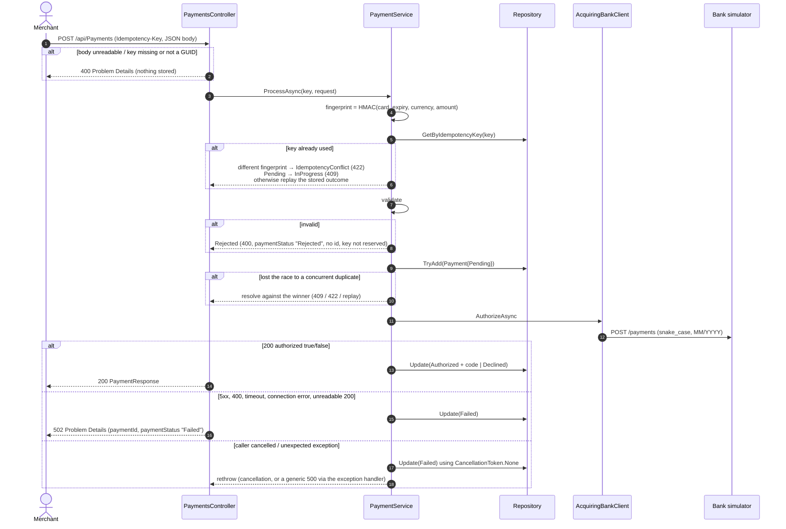
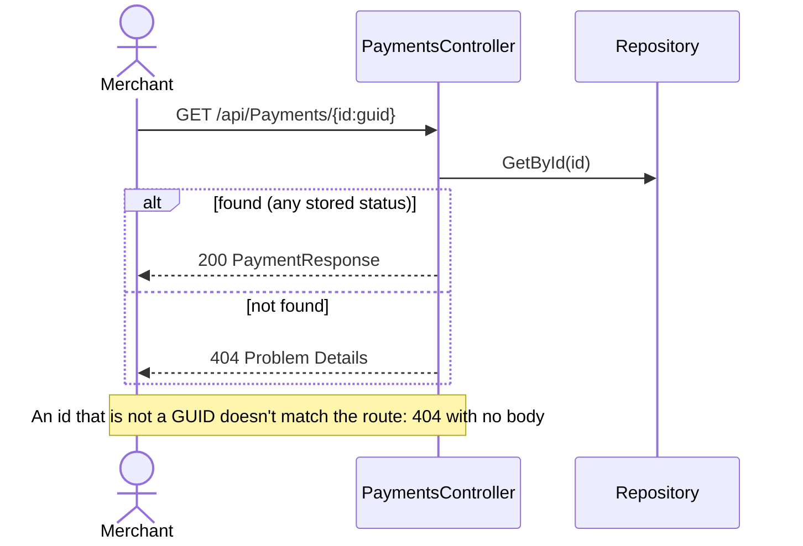
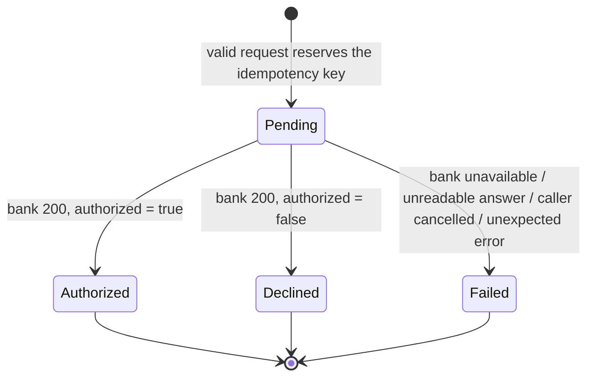

# Payment Gateway API: architecture and design

> **Status:** feature-complete for the challenge. 117 automated tests pass: 93 unit, 21 integration and 3 end-to-end against the bank simulator. The build history is in the [appendix](#appendix-build-history).

## Contents
1. [Overview](#1-overview)
2. [Requirements traceability](#2-requirements-traceability)
3. [Solution structure](#3-solution-structure)
4. [Request flows](#4-request-flows)
5. [Payment lifecycle](#5-payment-lifecycle)
6. [HTTP contract](#6-http-contract)
7. [Key design decisions](#7-key-design-decisions)
8. [Validation rules and bank mapping](#8-validation-rules-and-bank-mapping)
9. [Security and card data](#9-security-and-card-data)
10. [Observability](#10-observability)
11. [Testing strategy](#11-testing-strategy)
12. [Assumptions](#12-assumptions)
13. [Known limitations](#13-known-limitations)
14. [Production roadmap](#14-production-roadmap)
15. [Changes from the template](#15-changes-from-the-template)
- [Appendix: build history](#appendix-build-history)

---

## 1. Overview

The gateway is an ASP.NET Core 8 Web API. Merchants use it to:
- **process a card payment** (`POST /api/Payments`). The request is validated, and a valid request is sent to the acquiring bank (the Mountebank simulator). The result is **Authorized**, **Declined** or **Rejected**.
- **retrieve a previous payment** (`GET /api/Payments/{id}`), with the card number masked to its last four digits.

The gateway also has idempotent POSTs (an `Idempotency-Key` header) and records bank outages as a `Failed` payment. These go beyond the brief, but a payment API that can double-charge on a client retry, or lose track of a payment the bank may have seen, isn't credible.

**Running it**
```bash
docker-compose up -d                                         # bank simulator on localhost:8080
export RequestFingerprint__Secret='<at least 32 bytes>'      # required; the app refuses to start without it
dotnet run --project src/PaymentGateway.Api                  # Swagger UI at /swagger in Development
dotnet test --filter "Category!=BankSimulator"               # unit and integration tests, no dependencies
dotnet test --filter "Category=BankSimulator"                # end-to-end tests, needs the simulator
```

---

## 2. Requirements traceability

These are the challenge requirements and the code and tests that meet them.

| Requirement | Implementation | Tests |
|---|---|---|
| POST a payment; the bank's answer gives **Authorized** or **Declined** | `PaymentService.ProcessAsync` → `IAcquiringBankClient`; `200` + `PaymentResponse` | `PaymentServiceTests` (Authorizes, Declines), `PaymentsControllerTests.PostsValidPayment…`, `PaymentsBankSimulatorTests` (cards ending in 1 and 2) |
| **Rejected**: invalid information, no payment created, bank not called | Validation runs before any key reservation or bank call; `400` with `paymentStatus: "Rejected"` and no id | `PostsInvalidPaymentWithoutCreatingPaymentRecord`, `ProcessAsync_InvalidRequest_*` |
| Response: id, status, **last four digits only**, expiry month and year, currency, amount | `PaymentResponse.From(Payment)`; the domain `Payment` never holds the full number | `PostsValidPaymentAndReturnsMaskedPaymentResponse` (asserts the full PAN and CVV are absent) |
| GET a previous payment by id | `PaymentsController.GetPaymentAsync` → repository | `RetrievesAPaymentSuccessfully`, `PostedPaymentCanBeRetrieved`, `Returns404IfPaymentNotFound` |
| Card number: required, 14–19 characters, digits only | `PostPaymentRequestValidator` | `PostPaymentRequestValidatorTests` (boundaries 13/14/19/20, spaces, letters, null) |
| Expiry month 1–12; month and year together in the future | Validator using the injected `TimeProvider` | Month 0/1/12/13; last month, this month and next month with `FakeTimeProvider` |
| Currency: 3-letter ISO code, at most 3 supported | Allow-list `GBP`, `USD`, `EUR` | Supported, unsupported, lowercase, 4 letters, empty, null |
| Amount: integer in minor units | `int?`, must be > 0 | 0, -1, null, 1, `int.MaxValue` |
| CVV: required, 3–4 characters, digits only | Validator; a string, so leading zeros survive | 2/3/4/5 characters, `012`, letters, null |
| Bank simulator contract (snake_case, `MM/YYYY`, 503 for cards ending in 0) | `AcquiringBankClient` | `AcquiringBankClientTests`, `PaymentsBankSimulatorTests` (card ending in 0 → `502`, stored `Failed`) |
| A test double for storage is acceptable | `InMemoryPaymentsRepository` behind `IPaymentsRepository` | `InMemoryPaymentsRepositoryTests` |
| Code compiles and is covered by automated tests | 117 tests across three levels | see [§11](#11-testing-strategy) |
| Design considerations and assumptions documented | This document and the README's *Design decisions and assumptions* | — |

---

## 3. Solution structure

The code is one API project and one test project, split into folders by responsibility. Each external dependency (storage, bank, clock) sits behind an interface or abstraction, so it can be substituted in tests and replaced in production.

```
src/PaymentGateway.Api/
  Program.cs                                 DI, validated options, typed HttpClient, Problem Details, JSON enums as strings
  Controllers/PaymentsController.cs          HTTP only: header parsing, PaymentResult → HTTP mapping, GET by id
  Models/Requests/PostPaymentRequest.cs      merchant input: all fields nullable; card number and CVV are strings
  Models/Responses/PaymentResponse.cs        merchant output: masked card, status as a string
  Domain/Payment.cs                          stored entity (immutable record); never holds the PAN or CVV
  Domain/PaymentStatus.cs                    Pending, Authorized, Declined, Rejected (response only), Failed
  Validation/PostPaymentRequestValidator.cs  FluentValidation rules; messages never echo input
  Services/IPaymentService.cs, PaymentService.cs   orchestration: idempotency → validate → reserve → bank → persist
  Services/PaymentResult.cs                  closed set of outcomes: Processed | Rejected | BankUnavailable | IdempotencyConflict | InProgress
  Services/RequestFingerprinter.cs           HMAC-SHA256 of the request for idempotency comparison (CVV excluded)
  Services/RequestFingerprintOptions.cs      the HMAC secret (required, ≥ 32 bytes, validated at startup)
  Persistence/IPaymentsRepository.cs         TryAdd (atomic key reservation), GetById, GetByIdempotencyKey, Update
  Persistence/InMemoryPaymentsRepository.cs  two ConcurrentDictionary indexes: by id and by idempotency key
  Bank/IAcquiringBankClient.cs               the acquirer boundary
  Bank/AcquiringBankClient.cs                wire format (private snake_case record, MM/YYYY); maps failures to one exception
  Bank/BankPaymentRequest.cs, BankPaymentResponse.cs   internal models; `Authorized` is [JsonRequired]
  Bank/AcquiringBankOptions.cs               BaseUrl and Timeout (appsettings "AcquiringBank"), validated at startup
  Bank/AcquiringBankUnavailableException.cs  the only exception the bank client is expected to throw
test/PaymentGateway.Api.Tests/
  Unit/         validator, fingerprinter, service, bank client (stub HttpMessageHandler), repository
  Integration/  WebApplicationFactory<Program> with a substituted IAcquiringBankClient
  EndToEnd/     [Trait("Category","BankSimulator")], real HTTP to the running simulator
```

**Dependencies between layers:** Controller → Service → (Validator, Fingerprinter, Repository, Bank client, `TimeProvider`). The controller also reads the repository directly for GET ([§7.8](#78-get-reads-the-repository-directly)). The domain depends on nothing.

**Why one project:** the brief asks for simplicity, and the code base is small. Splitting into Domain, Application and Infrastructure assemblies would add ceremony without adding protection at this size. The folders already follow those boundaries, so the split is mechanical if the service grows.

---

## 4. Request flows

### POST /api/Payments



The idempotency lookup happens **before** validation, so a retry of an already-processed key gets its stored answer even if a later client bug sends an invalid body (it gets `422`, because the fingerprint differs). Only a *valid* request reserves a key.

### GET /api/Payments/{id}



---

## 5. Payment lifecycle



- **Rejected is not a stored state.** An invalid request gets a `400` with `paymentStatus: "Rejected"`, but no record or id is created, so it can't be retrieved. The `Rejected` enum value exists only to name that response.
- **Failed** means "the gateway does not know whether the bank processed this". The gateway never retries automatically; the merchant retries with a **new** key.
- **Pending** is only seen by a concurrent duplicate request (`409`) or, after a process crash, by GET (see [§13](#13-known-limitations)).

---

## 6. HTTP contract

All errors are [RFC 9457 Problem Details](https://www.rfc-editor.org/rfc/rfc9457) (`application/problem+json`) with `type`, `title`, `status` (the HTTP code) and `traceId`. Where a problem relates to a payment, the payment outcome is in **`paymentStatus`**, because `status` is reserved by Problem Details.

| Case | Response | Stored as |
|---|---|---|
| Valid, bank authorizes | `200` PaymentResponse, `status: "Authorized"` | Authorized (with authorization code, not returned) |
| Valid, bank declines | `200` PaymentResponse, `status: "Declined"` | Declined |
| Invalid fields | `400` ValidationProblemDetails, camelCase `errors`, `paymentStatus: "Rejected"`, no id | not stored; key stays available |
| Bank 5xx / 400 / timeout / unreachable / unreadable answer | `502`, `paymentId`, `paymentStatus: "Failed"` | Failed |
| Unexpected server error | `500` generic Problem Details (no exception detail) | Failed if the key was already reserved |
| Replay (same key, same fingerprint) | the original status code and body | — |
| Same key, different fingerprint | `422` | — |
| Same key, first request still `Pending` | `409` | — |
| Missing `Idempotency-Key` | `400` ValidationProblemDetails (framework default) | not stored |
| `Idempotency-Key` not a GUID | `400` `"Invalid Idempotency-Key"` | not stored |
| Body unreadable (wrong types, not JSON, empty) | `400` `"Invalid request body"`, no serializer details | not stored |
| GET existing id (any stored status) | `200` PaymentResponse | — |
| GET unknown id | `404` Problem Details | — |
| GET with an id that isn't a GUID | `404` with no body (route constraint) | — |

**Example responses** (captured from the running API against the simulator):

```jsonc
// 200 Authorized (card ending 7)
{"id":"9da4e68c-9280-4b9b-b497-e918c8d572f8","status":"Authorized","cardNumberLastFour":"8877",
 "expiryMonth":4,"expiryYear":2030,"currency":"GBP","amount":1050}

// 400 Rejected
{"type":"https://tools.ietf.org/html/rfc9110#section-15.5.1","title":"One or more validation errors occurred.",
 "status":400,"errors":{"cardNumber":["Card number must be between 14 and 19 characters long."],
 "expiryMonth":["Expiry month must be between 1 and 12."],"currency":["Currency must be one of: GBP, USD, EUR."],
 "amount":["Amount must be greater than 0."],"cvv":["CVV must be 3 or 4 characters long."]},
 "traceId":"00-bcbe…-00","paymentStatus":"Rejected"}

// 502 Failed (card ending 0)
{"type":"https://tools.ietf.org/html/rfc9110#section-15.6.3","title":"Acquiring bank unavailable","status":502,
 "traceId":"00-5e04…-00","paymentId":"89962bc1-abf6-41c2-b942-dd84cc1307a8","paymentStatus":"Failed"}

// 400 unreadable body
{"type":"https://tools.ietf.org/html/rfc9110#section-15.5.1","title":"Invalid request body","status":400,
 "detail":"The request body must be a JSON payment request.","traceId":"00-4952…-00"}
```

Swagger (Development only) documents the `Idempotency-Key` header and every response type.

---

## 7. Key design decisions

Each decision below gives what was chosen, why, and the main alternative.

### 7.1 Idempotency is in scope
**Chosen:** `Idempotency-Key` (GUID) is required on POST. One payment per key; retries replay the stored outcome without calling the bank again.
**Why:** a network timeout between merchant and gateway is normal. Without idempotency, the safe retry is a second charge.
**Alternative:** leave it out because the brief doesn't ask for it. That's simpler, but it isn't a defensible property for a payment API.

### 7.2 Atomic key reservation before the bank call
**Chosen:** a `Pending` payment is inserted with `TryAddAsync` (backed by `ConcurrentDictionary.TryAdd`, which maps to a unique constraint in a database) *before* the bank is called.
**Why:** a "check then insert" approach lets two concurrent duplicates both reach the bank. A test fires 10 concurrent duplicates and asserts a single bank call.
**Alternative:** a distributed lock. That adds more infrastructure for the same guarantee.

### 7.3 Request fingerprint: HMAC-SHA256, CVV excluded
**Chosen:** an HMAC-SHA256 over card number, expiry, currency and amount, keyed with a secret from configuration (≥ 32 bytes, validated at startup).
**Why:**
- The fingerprint tells "same retry" apart from "key reused for a different payment" (`422`).
- A **plain** hash of a 16-digit PAN can be brute-forced, so it would effectively store card data. The secret key prevents that.
- The CVV must not be retained after authorization (PCI DSS), so it's excluded. A retry that differs only by CVV is still a replay.

**Alternative:** store the whole request. That would store the PAN and CVV, which isn't acceptable.

### 7.4 409 vs 422
- **`422`:** same key, *different* request. This is a client bug, and retrying won't help.
- **`409`:** same key, same request, still `Pending`. This is transient, so the client should retry later.

Splitting them tells the client whether retrying is useful.

### 7.5 Bank outage → store `Failed` and return `502`
**Chosen:** a bank 5xx, timeout, connection error, a bank `400`, or an unreadable `200` all become `AcquiringBankUnavailableException`. The payment is stored as `Failed`, and the merchant gets `502` with the `paymentId`.
**Why:**
- The merchant gets an id to reconcile against later.
- The response says the gateway's *upstream* failed, not the merchant's request.
- A missing `authorized` field is treated as a failure, not a decline, because guessing `Declined` could hide a payment the bank approved.

**Alternative:** `200` with `status: "Failed"`. That's rejected because it makes a failure look like success to generic HTTP tooling and monitoring.

### 7.6 No automatic retries to the bank
A timed-out authorization may have succeeded at the bank, and retrying risks a double charge. The bank client has a configurable timeout (5 s default) and no retry policy. Safe retries need bank-side idempotency, which the simulator doesn't offer.

### 7.7 Rejected requests are not stored and don't reserve the key
**Why:**
- The brief says a rejected request creates no payment.
- Not reserving the key lets the merchant fix a typo and resend with the same key.
- Validation failures can't cause a charge, so there's nothing to deduplicate.

### 7.8 GET reads the repository directly
GET is a read with no business rules, so a service method would only pass the call through. When reads gain rules (merchant scoping, authorization), they move into a query service.

### 7.9 `PaymentResult` instead of exceptions for expected outcomes
Rejected, conflict, in-progress and bank-unavailable are normal results, so `ProcessAsync` returns a closed set of records. The controller is a single `switch` from result to HTTP response, and the service has no HTTP knowledge. Exceptions are reserved for the unexpected, and the global handler returns a generic `500`.

### 7.10 Interrupted bank calls never leave a payment `Pending`
If the caller cancels, or anything unexpected is thrown during the bank call, the payment is updated to `Failed` using `CancellationToken.None` (the caller's token may already be cancelled), a warning is logged, and the exception is rethrown. Without this, the key would return `409` forever. The first response stays a `500`, so bugs aren't hidden behind "bank unavailable"; replays return `502` with the `paymentId`.

### 7.11 Validation with FluentValidation and an injected `TimeProvider`
- The rules sit in one readable class.
- `TimeProvider` makes the expiry rules testable at month boundaries with `FakeTimeProvider`.
- Request fields are nullable so that a *missing* field reaches the validator and becomes `Rejected`, rather than failing model binding.

### 7.12 Fail fast on configuration
`AcquiringBank:BaseUrl` (absolute http/https), `AcquiringBank:Timeout` (> 0) and `RequestFingerprint:Secret` (≥ 32 bytes) are validated with `ValidateOnStart`. A misconfigured instance won't start, instead of failing on its first payment.

### 7.13 Error responses
- Every error goes through the framework's `ProblemDetailsFactory`, so they all have the same shape and a `traceId`.
- Validation error keys use the JSON field names (`cardNumber`).
- Serializer messages for an unreadable body are replaced by a generic one.
- Unhandled exceptions never expose their message.

---

## 8. Validation rules and bank mapping

**Validation** (`PostPaymentRequestValidator`):
- Every field is required.
- Card number: 14–19 characters, ASCII digits only. There is no Luhn check; the brief doesn't ask for one, and the simulator's test cards don't need it.
- Expiry month: 1–12.
- Expiry: `(year, month) >= (now.Year, now.Month)`, so a card is valid through its expiry month. The error is reported on a combined `expiryDate` key, and only when month and year are individually valid (so a bad month gives only the month error).
- Currency: `GBP`, `USD` or `EUR`, uppercase.
- Amount: an integer in minor units, > 0.
- CVV: 3–4 characters, digits only.
- Messages are fixed strings and never include the submitted value.

**Bank mapping** (`AcquiringBankClient`):
- **Request:** `POST /payments` with `{ card_number, expiry_date: "MM/YYYY", currency, amount, cvv }`.
- **Response:** `{ authorized, authorization_code }`; `authorized` is required.
- **Errors:** any non-success status, `HttpRequestException`, `HttpClient` timeout, empty, `null` or malformed body all become `AcquiringBankUnavailableException`. Cancellation by the caller's own token passes through unchanged.
- **Client setup:** a typed `HttpClient` through `IHttpClientFactory` (pooled handlers, no socket exhaustion).

---

## 9. Security and card data

| Data | Stored | Logged | Returned |
|---|---|---|---|
| Full card number (PAN) | No. Only the last four digits and an HMAC inside the fingerprint | No | No |
| CVV | No (not even in the fingerprint) | No | No |
| Last four, expiry, currency, amount | Yes | No | Yes |
| Authorization code | Yes | No | No |
| Request fingerprint | Yes | No | No |

Other protections:
- Validation messages never echo input.
- Unhandled exception messages aren't returned (tested).
- Serializer errors aren't returned.
- The HMAC secret comes from configuration (for example the `RequestFingerprint__Secret` environment variable), not source control.

**Out of scope:** merchant authentication and authorization (see [§13](#13-known-limitations) and [§14](#14-production-roadmap)). The gateway receives raw PANs, so a production deployment is in full PCI DSS scope.

---

## 10. Observability

`PaymentService` writes structured log events using message templates. Every event includes `ElapsedMilliseconds`, and includes `PaymentId` once a payment exists. No event includes card data, CVV or the fingerprint (asserted in unit tests).

| Event | Level | Properties |
|---|---|---|
| Payment completed with outcome Authorized/Declined | Information | `Outcome`, `PaymentId` |
| Payment request rejected by validation | Information | `ValidationErrorCount` |
| Acquiring bank unavailable; payment marked Failed | Warning (+ exception) | `Outcome`, `PaymentId` |
| Payment processing interrupted; payment marked Failed | Warning (+ exception) | `Outcome`, `PaymentId` |
| Idempotency key reused with a different payment request | Warning | `PaymentId` |
| Payment request is already in progress | Information | `PaymentId` |
| Idempotent payment request replayed | Debug | `Outcome`, `PaymentId` |

ASP.NET Core and `IHttpClientFactory` add their own request logs and a `traceId`, which is also returned in every Problem Details response for correlation. Metrics and distributed tracing are on the roadmap.

---

## 11. Testing strategy

The solution was built test-first: for each behaviour, a failing test, then the minimal code, then a refactor. The [appendix](#appendix-build-history) has the step-by-step history, and git history shows the increments.

| Level | Count | What it covers | Main seams |
|---|---|---|---|
| **Unit** | 93 | Validator (44), service (16), bank client (13), fingerprinter (10), repository (10) | `FakeTimeProvider`, NSubstitute bank client, stub `HttpMessageHandler`, real in-memory repository, capturing logger |
| **Integration** | 21 | Every row of the HTTP contract, POST then GET, replay, conflict, in-progress, error shapes, no card data in responses | `WebApplicationFactory<Program>` with a substituted `IAcquiringBankClient` |
| **End-to-end** | 3 | Real HTTP to the Mountebank simulator: card ending in 1 → `200` Authorized, 2 → `200` Declined, 0 → `502` Failed; each retrievable by GET | `[Trait("Category","BankSimulator")]`; the simulator must be running |

**Notable tests:**
- Concurrency: 10 parallel duplicates → exactly one bank call.
- Repository: parallel `TryAdd` on the same key → exactly one wins.
- A cancellation test uses a repository that honours the caller's token, to prove the `Failed` update can't be skipped.
- Tests assert that the full PAN and CVV never appear in stored payments, responses or logs.

**Tools:** xUnit, Shouldly, NSubstitute, `Microsoft.AspNetCore.Mvc.Testing`, `Microsoft.Extensions.TimeProvider.Testing`, coverlet (`dotnet test --collect:"XPlat Code Coverage"`).

---

## 12. Assumptions

1. Merchant authentication is out of scope, so idempotency keys are unique across all merchants. With authentication, they would be scoped to (merchant, key).
2. The response statuses are the spec's `Authorized`, `Declined` and `Rejected`, plus `Pending` (in flight) and `Failed` (bank outcome unknown). Only `Pending`, `Authorized`, `Declined` and `Failed` are stored.
3. Missing required fields are a validation failure (`Rejected`), not a protocol error.
4. A missing or non-GUID `Idempotency-Key`, and a body that can't be read as JSON, are protocol errors. They return `400` without `paymentStatus` and are not stored.
5. Replaying a reserved key returns its original outcome, including `502`. After a `Failed` payment, the merchant retries with a new key.
6. The card is valid through the end of its expiry month.
7. Supported currencies are GBP, USD and EUR, uppercase. The amount is an integer number of minor units and must be greater than zero.
8. A `400` from the bank means the gateway built a bad request. It's treated as `Failed` (`502`), not shown to the merchant as their error.
9. The in-memory store is per instance and lost on restart, which the brief allows.
10. `.editorconfig`, `imposters/` and `docker-compose.yml` are unchanged, as the template instructs.

---

## 13. Known limitations

| Limitation | Impact | Remedy |
|---|---|---|
| A process crash, or a failed repository update after the bank answers, leaves the payment `Pending` | The key returns `409` indefinitely; GET shows `Pending` | Reconciliation job that resolves stale `Pending` payments with the bank |
| A payment marked `Failed` after a timeout or cancellation may have been charged by the bank | `Failed` means "unknown", not "not charged" | Reconcile with the bank using a gateway reference; bank-side idempotency |
| No merchant authentication or authorization | Anyone with a payment id can read it; keys are global | Authentication (OAuth2 / API keys), scope keys and reads per merchant |
| In-memory, per-instance store | Data lost on restart; can't scale out | Shared database with a unique index on (merchant, key) |
| In-memory update writes two indexes non-atomically | A reader could briefly see different versions by id and by key | One row per payment in a database, updated transactionally with a version check |
| First response to an unexpected error is `500`; its replay is `502` | The two responses differ | Acceptable: the `500` surfaces bugs, and the replay carries the `paymentId` |
| Rotating the fingerprint secret changes fingerprints | Retries of keys created before the rotation get `422` | Store a key version with the fingerprint; accept the old key during rotation |
| `int` amount | Maximum 2,147,483,647 minor units (~£21.4M) | `long` if larger amounts are needed |
| Currency list is hard-coded | Adding a currency needs a deployment | Configuration, or per-merchant settings |
| The missing-header error is the framework default (`"The idempotencyKey field is required."`) | Slightly inconsistent wording | Custom message if it matters |

---

## 14. Production roadmap

Roughly in priority order:
1. **Merchant authentication**, with keys and GET scoped per merchant.
2. **Durable storage:** a database with a unique constraint on (merchant, key), optimistic concurrency, and a migration path from `IPaymentsRepository`.
3. **Reconciliation** of `Pending` and `Failed` payments against the acquirer.
4. **Resilience:** a circuit breaker and a total time budget on the bank client (no blind retries), plus bulkheading per acquirer.
5. **Observability:** OpenTelemetry traces and metrics (authorization rate, bank latency, failure rate), health checks (`/health`, including bank reachability), and alerts on `Failed` and stale `Pending` payments.
6. **Security:** tokenization or a vault for PANs to reduce PCI scope, secrets in a key vault, HTTPS only, rate limiting, request size limits.
7. **API lifecycle:** versioning (`/v1`), a published OpenAPI contract, and a defined idempotency-key retention window (for example 24 hours).
8. **Multiple acquirers:** routing behind `IAcquiringBankClient`.

---

## 15. Changes from the template

| Template issue | Change |
|---|---|
| GET returned `200` with a `null` body for unknown ids; `async` without `await` | `404`; real async through the repository |
| `PostPaymentRequest` had `CardNumberLastFour` (int) and no full card number; `Cvv` and last four were `int`, which loses leading zeros | Full `CardNumber`; card number, CVV and last four are strings |
| `PaymentsRepository` was a concrete class with a public, non-thread-safe `List` storing response DTOs | `IPaymentsRepository` with a `ConcurrentDictionary` implementation storing a domain `Payment` |
| `PaymentStatus` in `Enums/` with namespace `…Models` | Moved to `Domain/` |
| Test project used `Mvc.Testing 6.0.24` on net8, and old xUnit and SDK versions | Upgraded |
| Sample test used `Random.Next(1, 12)`, which never produces 12 | Deterministic test data |

---

## Appendix: build history

Each step was done red → green → refactor and reviewed before the next.

| Step | Outcome |
|---|---|
| 1. Tooling | Packages upgraded; `public partial class Program` for `WebApplicationFactory` |
| 2. Repository | `IPaymentsRepository` + `InMemoryPaymentsRepository`; atomic `TryAdd`; parallel test |
| 3. GET endpoint | `404` for unknown ids; masked `PaymentResponse`; template DTOs removed |
| 4. Validator | `PostPaymentRequest` reshaped (nullable, string digits); all field rules with `TimeProvider` |
| 5. Bank client | snake_case / `MM/YYYY` wire format; all failures → `AcquiringBankUnavailableException`; caller cancellation propagates |
| 6. Payment service | HMAC fingerprint; Rejected without storing; Authorized / Declined / Failed persisted; replay, conflict, in-progress; atomic reservation |
| 7. POST endpoint | Controller mapping of `PaymentResult`; DI and validated options; contract integration tests written first |
| 8. End-to-end | Tests against the running simulator for cards ending in 1, 2 and 0 |
| 9. Refactor and document | Global Problem Details exception handling; Swagger header and response docs; README assumptions; structured logging |
| 10. No stuck `Pending` | Caller cancellation and unexpected errors mark the payment `Failed`; unreadable `200` bank responses become `502` |
| 11. Error contract | `paymentStatus` replaces the duplicate `status` key; `type` and `traceId` on every problem; generic unreadable-body error; camelCase validation keys |
